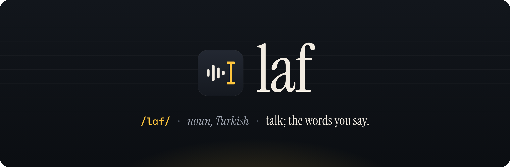
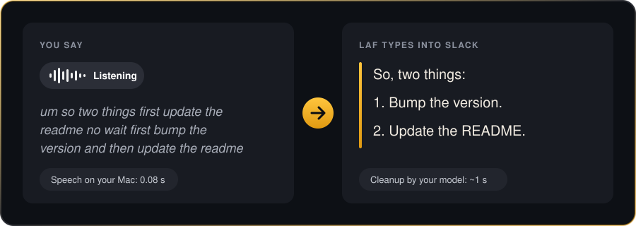
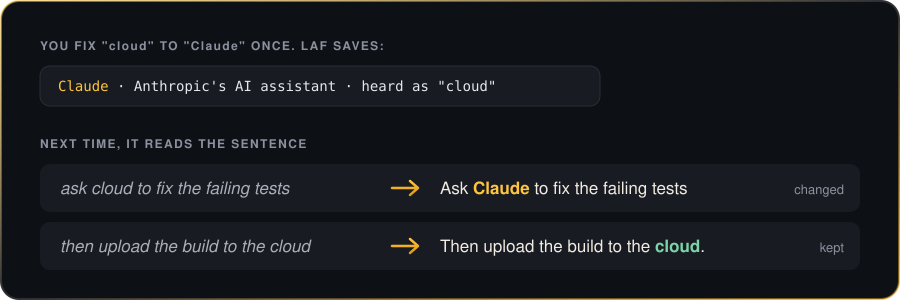

<div align="center">



<h3>Dictation that types what you meant</h3>

<p>Hold a key and talk. Speech recognition runs on your computer,<br />and Laf learns your names and terms from the fixes you make.</p>

<p>
  <a href="https://github.com/berkay-digital/laf/actions/workflows/ci.yml"></a>
  <a href="LICENSE"></a>
  
  
  
</p>

<p>
  <a href="#install">Install</a> ·
  <a href="#it-learns-from-your-edits">How it learns</a> ·
  <a href="#set-up-the-language-model">Models</a> ·
  <a href="#privacy">Privacy</a> ·
  <a href="#settings">Settings</a>
</p>

</div>

<br />

<p align="center">
  
</p>

## Why Laf

<table>
  <tr>
    <td width="50%" valign="top">
      <h3>Types what you meant</h3>
      Filler words, false starts and "no wait" corrections are gone. Punctuation is fixed, lists become lists, and your wording stays yours.
    </td>
    <td width="50%" valign="top">
      <h3>Learns from your fixes</h3>
      Correct a name once and Laf remembers it, along with how it was misheard. No word list to keep by hand.
    </td>
  </tr>
  <tr>
    <td width="50%" valign="top">
      <h3>Fast and local speech</h3>
      On a Mac, Parakeet runs on the Neural Engine and transcribes a clip in 0.08 s. Your audio never leaves the computer.
    </td>
    <td width="50%" valign="top">
      <h3>Your model, your bill</h3>
      Use any OpenAI-compatible API, or a local model through Ollama. The default costs about 2 cents per 100 dictations.
    </td>
  </tr>
  <tr>
    <td width="50%" valign="top">
      <h3>Fits the app you're in</h3>
      Chat messages stay casual, emails get full sentences, and prompts for coding agents keep commands and file names exact.
    </td>
    <td width="50%" valign="top">
      <h3>Never loses what you said</h3>
      If the model can't be reached, Laf types the raw transcript. Esc cancels a recording at any time.
    </td>
  </tr>
</table>

## How to use it

| | macOS | Windows |
| --- | --- | --- |
| Dictate | Hold **Right Option**, speak, let go | Hold **Right Ctrl**, speak, let go |
| Hands-free | Tap Right Option, speak, tap again | Tap Right Ctrl, speak, tap again |
| Cancel | Esc | Esc |
| Add a word | Menu bar icon, then **Add word…** | Tray icon, then **Add word…** |

## It learns from your edits

<p align="center">
  
</p>

After Laf types something, it watches that text field through the system accessibility API for up to 90 seconds. If you fix a word, Laf sends the before and after to the model and asks what the fix teaches. Names and terms go into a word list with how they were misheard, what they are and an example sentence. Formatting habits, such as "no period at the end of chat messages", are saved as style rules.

Saved words aren't swapped in blindly. The model checks each sentence, so "ask cloud to fix the failing tests" becomes "Ask Claude to fix the failing tests", but "upload the build to the cloud" keeps the word cloud. Both examples above are real output from the default model.

The word list is a plain JSON file. You can edit it, copy it between machines (Mac and Windows use the same format), or add words from the menu.

## Speed and accuracy

Measured on an M1 Mac with 8 GB of RAM over 102 clips (LibriSpeech, accented English from EdAcc and synthetic dictation):

| Engine | Word error rate | Time per clip | Memory |
| --- | ---: | ---: | ---: |
| **Parakeet TDT v2** on the Neural Engine | **5.3%** | **0.08 s** | about 130 MB |
| Whisper small.en (whisper.cpp) | 7.2% | 0.67 s | |

The cleanup step adds about a second with the default model.

## Install

### macOS

You need an Apple Silicon Mac on macOS 14 or later, and Xcode or the Xcode command line tools (`xcode-select --install`).

```sh
git clone https://github.com/berkay-digital/laf.git
cd laf
./macos/build.sh
open ~/Applications/Laf.app
```

On first launch, macOS asks for microphone and Accessibility access. Accessibility lets Laf see the hotkey, paste text and notice your edits. The speech model downloads once, the first time Laf starts.

`build.sh` signs the app with a self-signed certificate called "Laf Local Signing", which it creates in your login keychain the first time. With a stable signature, macOS keeps Laf's permissions when you rebuild. Ad-hoc signed builds lose them on every build.

> [!NOTE]
> Tagged releases also have a prebuilt `Laf-macOS.zip`. It isn't notarized, so macOS blocks it the first time you open it. Go to System Settings, then Privacy & Security, and click **Open Anyway**.

### Windows

You need Windows 10 or 11. Download the repository (or `Laf-Windows.zip` from a release), open PowerShell in the `windows` folder as your normal user, and run:

```powershell
powershell -ExecutionPolicy Bypass -File .\setup.ps1
```

The script installs everything into your user profile, downloads whisper.cpp (the CUDA build if you have an NVIDIA GPU) and a speech model, and starts Laf in the tray. See [windows/README.md](windows/README.md) for details and troubleshooting.

## Set up the language model

Laf works with any OpenAI-compatible chat API. The default is [OpenRouter](https://openrouter.ai) with `anthropic/claude-haiku-5.5`, which costs about 2 cents per 100 dictations. Create a key there, then choose **Set API key…** in the Laf menu.

To use something else, change `apiBaseURL` and `model` in the settings file (menu, then **Open settings file**):

| Provider | `apiBaseURL` | Key needed |
| --- | --- | :---: |
| OpenRouter | `https://openrouter.ai/api/v1` | yes |
| OpenAI | `https://api.openai.com/v1` | yes |
| Groq | `https://api.groq.com/openai/v1` | yes |
| Ollama | `http://localhost:11434/v1` | no |
| LM Studio | `http://localhost:1234/v1` | no |

With Ollama or LM Studio, nothing leaves your computer. Small local models follow the cleanup rules less reliably than hosted ones, so try a few on your own dictations.

For harder cleanup, such as heavy accents or lots of jargon, a reasoning model helps. On OpenRouter, `"model": "openai/gpt-6.1-sol"` with `"reasoningEffort": "low"` is more careful, but it takes about two seconds and costs at least 20 times more.

## Privacy

- Audio never leaves your computer. The speech server listens on 127.0.0.1 only.
- Laf sends the transcript, the name of the app you're typing into and any matching entries from your word list to the chat API you set up. With a local model, that stays on your machine too.
- When you edit a dictation, Laf sends the original and your edited version of that one passage to the same API, so it can learn from the edit. It reads only the text it typed and never reads password fields. You can turn this off with **Learn from my edits**.
- Your API key, word list, history and log stay on your computer, in your user folder. On a Mac, the settings file is readable only by your user account. Turn off **Save history** if you don't want a record of your dictations.
- Laf pastes through the clipboard. It marks the text as transient so clipboard managers skip it, then puts back whatever you had copied before.

## Settings

The settings file is `~/Library/Application Support/Laf/config.json` on a Mac and `%APPDATA%\Laf\config.json` on Windows. Laf rereads it at the start of each dictation. Changes to the hotkey or the speech engine apply after you quit and reopen Laf.

<details>
<summary><b>All settings</b></summary>
<br>

| Key | Default | What it does |
| --- | --- | --- |
| `apiBaseURL` | `https://openrouter.ai/api/v1` | Chat API endpoint |
| `apiKey` | empty | Key for that API |
| `model` | `anthropic/claude-haiku-5.5` | Model used for cleanup and learning |
| `reasoningEffort` | empty | `none`, `minimal`, `low`, `medium` or `high` for reasoning models |
| `hotkey` | `rightOption` (Mac), `right ctrl` (Windows) | Mac: `rightOption`, `rightCommand` or `fn`. Windows: any key name from the `keyboard` package |
| `language` | `en` | Language code passed to whisper.cpp |
| `learnFromEdits` | `true` | Watch your edits and learn from them |
| `saveHistory` | `true` | Keep a local log of what you said and what was typed |
| `launchAtLogin` | `true` | Start Laf when you log in |
| `appStyles` | chat, email and coding presets | Extra instructions per app. Keys are `\|`-separated parts of the app name |
| `speechEngine` | `parakeet` | Mac only: `parakeet` or `whisper` |
| `parakeetModel` | `v2` | Mac only: `v2` (English) or `v3` (25 European languages) |
| `whisperModel` | `small.en` model path | Path to a whisper.cpp model file |
| `speechPort` / `whisperPort` | `8178` | Local port for the speech server |

</details>

<details>
<summary><b>Other languages on a Mac</b></summary>
<br>

Parakeet v2 understands English only. Set `"parakeetModel": "v3"` for 25 European languages. For any other language, install whisper.cpp with `brew install whisper-cpp`, download a multilingual model, and set `speechEngine`, `whisperModel` and `language`:

```sh
mkdir -p ~/Library/Application\ Support/Laf/models
curl -L -o ~/Library/Application\ Support/Laf/models/ggml-large-v3-turbo-q5_0.bin \
  https://huggingface.co/ggerganov/whisper.cpp/resolve/main/ggml-large-v3-turbo-q5_0.bin
```

```json
"speechEngine": "whisper",
"whisperModel": "~/Library/Application Support/Laf/models/ggml-large-v3-turbo-q5_0.bin",
"language": "tr"
```

</details>

<details>
<summary><b>Troubleshooting</b></summary>
<br>

- **The hotkey does nothing.** Check that Laf is on in System Settings, then Privacy & Security, then Accessibility. If you rebuilt with ad-hoc signing, remove Laf from that list and add it again.
- **"Transcription failed."** Look at `speech.log` in the settings folder. The first dictation after launch can take longer while the model loads.
- **"Cleanup failed, typed raw transcript."** Look at `laf.log`. It usually means a wrong key, a wrong model name or no network.
- **Edits aren't learned in one app.** That app doesn't expose its text field to the accessibility API. Use **Add word…** instead.

</details>

## How it works

1. A global key listener starts recording when you hold the hotkey.
2. The audio goes to a local speech server (Parakeet or whisper.cpp) as a 16 kHz WAV file.
3. Laf picks the word list entries that appear in the transcript or sound like something in it, and sends them to the model with the transcript and the app's style note.
4. The cleaned text is pasted at the cursor.
5. An edit watcher reads the field until you send, clear or leave it. If the text Laf typed changed, the model turns the change into words and style rules.

The Mac app is a single Swift file, [macos/App/main.swift](macos/App/main.swift), plus a small speech server in [macos/parakeet-server](macos/parakeet-server). The Windows app is a Python port, [windows/laf.pyw](windows/laf.pyw), with the same prompts and word list format.

## Contributing

Bug reports and pull requests are welcome. See [CONTRIBUTING.md](CONTRIBUTING.md) for how to build and test.

## Credits

- [FluidAudio](https://github.com/FluidInference/FluidAudio) runs Parakeet on Core ML (Apache 2.0).
- [NVIDIA Parakeet TDT](https://huggingface.co/nvidia/parakeet-tdt-0.6b-v2) is the speech model on macOS (CC BY 4.0).
- [whisper.cpp](https://github.com/ggml-org/whisper.cpp) does speech recognition on Windows (MIT).

## License

Laf is released under the [MIT license](LICENSE).
